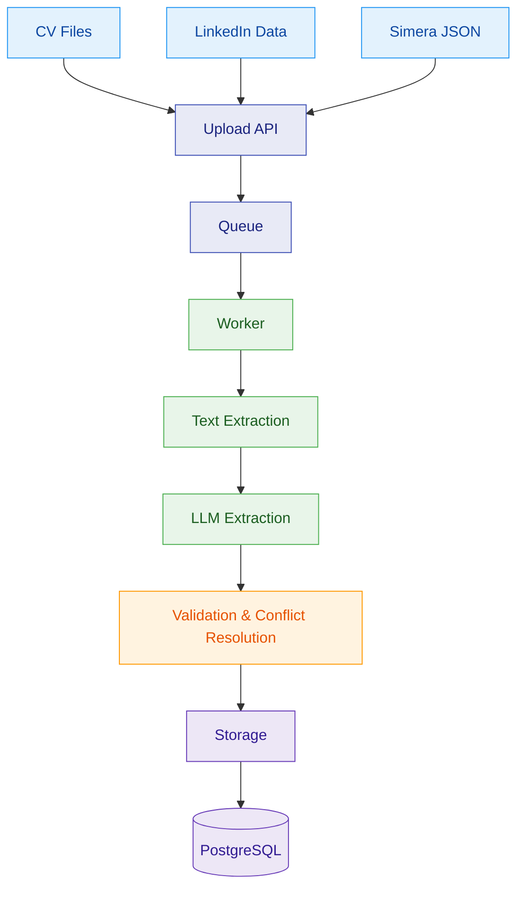

# TalentVault
## Multi-Source Resume Parsing & Data-Enrichment Sync

Simera is a candidate profile management system that automates the collection, extraction, validation, and synchronization of candidate information from multiple sources, including CVs, LinkedIn profiles, and Simera JSON files.

By combining automated data extraction, validation rules, conflict resolution, and data provenance, the system maintains structured and traceable candidate profiles while identifying information that requires human review.

## Table of Contents

- [Problem](#problem)
- [Solution](#solution)
- [System Architecture](#system-architecture)
- [Processing Workflow](#processing-workflow)
- [Features](#features)
- [Technology Stack](#technology-stack)
- [Project Structure](#project-structure)
- [Application Screenshots](#application-screenshots)
- [Setup & Installation](#setup--installation)
- [API Documentation](#api-documentation)
- [Testing](#testing)
- [Contributors](#contributors)

  
## Problem

Candidate information is often scattered across multiple sources, including CVs, LinkedIn profiles, and internal records. Consolidating and maintaining this information manually makes it difficult to ensure that candidate profiles remain accurate, consistent, and up to date, especially when information is duplicated, conflicting, or requires verification.

This creates several challenges:
- Fragmented information: Candidate data is spread across multiple sources.
- Conflicting data: Different sources may contain inconsistent or outdated information.
- Duplicate records: The same information may appear in different formats across sources.
- Lack of traceability: Difficulty tracking the source and evidence behind each value.
- Data reliability: Extracted information may be incomplete or inaccurate.
- Manual effort: Comparing sources and updating profiles is time-consuming and difficult to scale.

  
## Solution

Simera addresses these challenges through an automated multi-source processing pipeline that:

1. Collects candidate data from supported sources.
2. Extracts structured information using an LLM-based process.
3. Validates extracted data using application rules.
4. Detects conflicts and applies defined resolution rules.
5. Stores accepted information with its source, confidence, and supporting evidence.
6. Routes uncertain information for human review.

This results in centralized, structured, and traceable candidate profiles.

## System Architecture

The system follows a modular architecture consisting of a frontend, a REST API, a background worker, and a PostgreSQL database.

The API handles authentication, file uploads, and administrative requests, while the background worker processes uploaded files asynchronously. Both components use shared modules for common processing and data-management logic.


## Processing Workflow

The system processes candidate data through a sequence of automated stages, from file submission to structured profile storage.

1. **Data Upload:** Candidates upload their CV and LinkedIn data, while administrators can upload Simera JSON files.
2. **Queue Management:** Accepted uploads are added to a processing queue.
3. **Background Processing:** A worker extracts text and sends the collected data through the LLM extraction process.
4. **Validation & Conflict Resolution:** Extracted information is validated, and conflicts are handled using defined resolution rules.
5. **Data Storage:** Accepted information is stored in PostgreSQL along with its source, confidence, and evidence.
6. **Human Review:** Information requiring further verification is routed for human review.

## Features

| Feature | Description |
|---|---|
| **Multi-Source Data Ingestion** | Collect candidate information from CV files, LinkedIn data, and Simera JSON files. |
| **Automated Data Extraction** | Extract structured candidate information using an LLM-based process. |
| **Data Validation** | Validate extracted information using predefined rules to ensure data consistency and reliability. |
| **Conflict Detection & Resolution** | Detect conflicting information across sources and apply predefined resolution rules. |
| **Data Provenance** | Track the source, confidence score, and supporting evidence for each candidate profile field. |
| **Human Review** | Identify uncertain or conflicting information and route it for human verification. |
| **Candidate Management** | Allow administrators to search, filter, and view candidate profiles and their extracted information. |
| **File Processing Tracking** | Allow candidates to monitor the processing status of their uploaded files. |
| **Email Verification & Authentication** | Provide secure user authentication and email verification. |
| **Golden Dataset & Accuracy Measurement** | Evaluate extraction accuracy and conflict resolution using a synthetic reference dataset. |

## Technology Stack

The project is built using the following technologies:

| Category | Technology |
|---|---|
| Backend | Node.js, Express.js |
| Frontend | React |
| Database | PostgreSQL |
| Background Processing | Node.js Worker |
| AI & Data Extraction | Large Language Model (LLM) |
| Testing | Jest |
| Code Quality | ESLint, Prettier |
| Package Management | npm Workspaces |

## Project Structure

```text
simera-project-p3/
│
├── api/          # REST API and authentication
├── worker/       # Background processing
├── shared/       # Shared business logic
├── web/          # Frontend application
├── golden/       # Reference dataset and accuracy testing
│
├── package.json
└── README.md
```

## Application Screenshots

### Authentication
<!-- Add login and registration screenshots here -->

### Candidate Dashboard
<!-- Add candidate dashboard and file upload screenshots here -->

### Admin Dashboard
<!-- Add admin dashboard and candidate list screenshots here -->

### Candidate Profile
<!-- Add candidate profile details and data provenance screenshots here -->

## Setup & Installation

### Prerequisites

Make sure the following tools are installed:

- **Node.js** >= 22
- **npm**
- **PostgreSQL**

### 1. Clone the Repository

```bash
git clone https://github.com/hammoudFerwana/simera-project-p3.git
cd simera-project-p3
```

### 2. Install Dependencies

Install all project dependencies using npm:

```bash
npm ci
```

### 3. Environment Configuration

Create a `.env` file in the project root and configure the required environment variables.

The configuration includes:

| Variable | Description |
|---|---|
| `NODE_ENV` | Application environment |
| `API_PORT` | API server port |
| `DATABASE_URL` | PostgreSQL connection string |
| `TEST_DATABASE_URL` | Test database connection string |
| `GOLDEN_DATABASE_URL` | Dedicated database for golden accuracy measurements |
| `ADMIN_EMAIL` | Initial admin account email |
| `ADMIN_PASSWORD` | Initial admin account password |
| `SMTP_HOST`, `SMTP_PORT` | SMTP server configuration |
| `SMTP_USER`, `SMTP_PASS` | SMTP authentication credentials |
| `MAIL_FROM` | Sender email address |
| `JWT_SECRET` | Secret used to sign authentication tokens |
| `LLM_BASE_URL` | LLM provider API endpoint |
| `LLM_API_KEY` | LLM provider API key |
| `LLM_MODEL` | LLM model name |

Additional optional settings are available for file uploads, worker scheduling, skill matching, and review confidence thresholds.

**Important:**
- Use strong, unique values for passwords and secrets.
- Configure valid SMTP credentials for email verification.
- Provide a valid API key for the configured LLM provider.
- The golden measurement database name must start with `simera_golden`.
- Never commit your `.env` file or expose sensitive credentials.

### 4. Database Setup

Make sure PostgreSQL is running and the database connection is configured correctly.

Run the following command to create the database schema and seed the initial data:

```bash
npm run db:setup
```

### 5. Run the Application

Start each component in a separate terminal from the project root.

**Start the API server:**

```bash
npm run dev:api
```

**Start the background worker:**

```bash
npm run dev:worker
```

### 6. Run Tests

Run the project test suite:

```bash
npm test
```

To check code quality:

```bash
npm run lint
```

## API Documentation

The API documentation is available through Apidog and provides detailed information about the available endpoints, request parameters, authentication, and response formats.

[View API Documentation](https://share.apidog.com/94bb66e2-5545-4ec2-b634-25c3e3bf6f6d)

## Testing

The project uses Jest for automated testing to verify individual components, system integration, and overall data processing accuracy.

### Automated Tests

Unit tests verify individual modules and functions, including data extraction, validation, storage logic, and utility functions.

Run the test suite:

```bash
npm test
```

### Integration Tests

Integration tests verify the interaction between different system components, including API endpoints, database operations, and background processing workflows.

### Golden Dataset & Accuracy Measurement

The project includes a dedicated golden dataset consisting of 12 synthetic candidate files in different formats, with hand-written expected results.

The measurement runner processes these files through the actual pipeline and compares the resulting candidate profiles against the expected data.

It evaluates:

- Field extraction accuracy.
- Date exact-match rates.
- Experience duration matching.
- Automatic conflict resolution and human review decisions.
- Expected file rejection outcomes.

Generate the synthetic input files:

```bash
npm run golden:files
```

Run the accuracy measurement:

```bash
npm run golden
```

The measurement results are printed to the console and saved to `golden/report.md`.

The golden measurement requires a dedicated PostgreSQL database whose name starts with `simera_golden`.

### Code Quality

Run lint checks to identify code quality issues:

```bash
npm run lint
```

## Contributors

This project was developed by:

| Name | Role |
|---|---|
| Mohammed Ferwana | Backend Development |
| Beesan AbuMfarreh | Backend Development |
| Deema Hamoudeh | Backend Development |
| Bashar Shawar | Backend Development |
| Jeeda Sokkar | Frontend Development |
